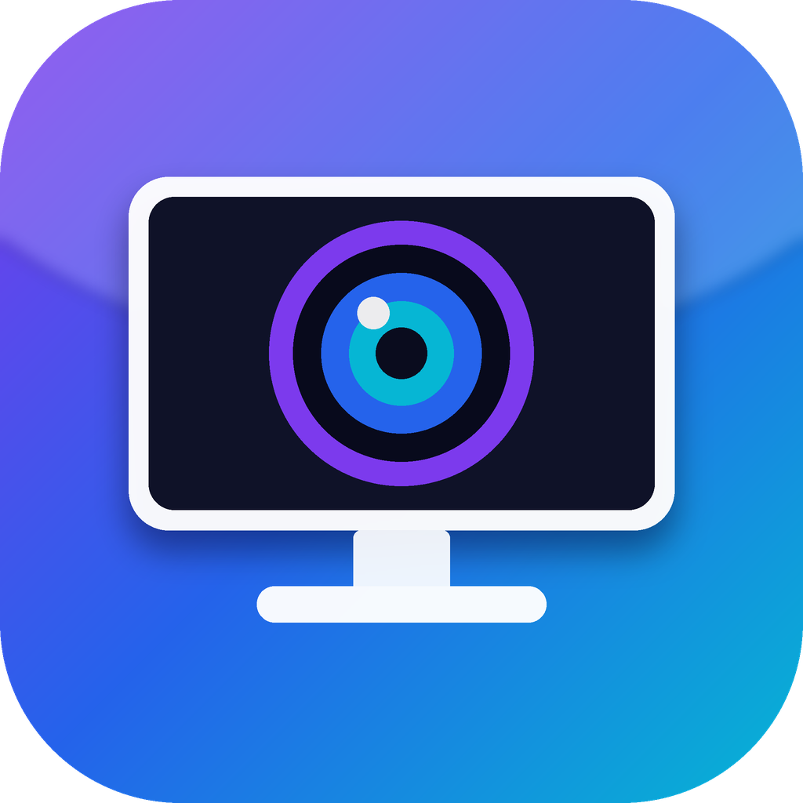

<h1 align="center">DeskLens</h1>

<b>Your desktop, as a camera.</b> Show your screen in Discord, Zoom, Teams, Google Meet or any app that uses a webcam.

  <a href="https://github.com/kloody60/DeskLens-Releases/releases/latest"><b>⬇ Download the latest version for Windows</b></a>

## Features
- A real camera named **DeskLens**. No OBS needed.
- **Auto share:** turn on your camera in Discord and your desktop shows up right away.
- Any screen or window, up to **4K at 60 fps**.
- No admin rights needed. Updates install automatically.
- 15 languages, including full Arabic (right-to-left) support.

## How to use
1. Install and open DeskLens, then pick a screen or window.
2. In Discord go to **Settings → Voice & Video → Camera** and choose **DeskLens**.
3. Turn on your camera.

> Windows SmartScreen may warn you because the installer is new and not code-signed yet. Click **More info → Run anyway**.

---

## بالعربي
**DeskLens** يحوّل سطح مكتبك إلى كاميرا باسم **DeskLens** تقدر تستخدمها في ديسكورد وأي برنامج فيه كاميرا ويب.

**[⬇ تحميل آخر إصدار](https://github.com/kloody60/DeskLens-Releases/releases/latest)**

1. ثبّت البرنامج وافتحه، واختر الشاشة.
2. في ديسكورد: الإعدادات ← الصوت والفيديو ← الكاميرا ← اختر **DeskLens**.
3. شغّل الكاميرا، ويطلع سطح مكتبك على طول.

> ممكن يطلع لك تحذير من ويندوز (SmartScreen) لأن البرنامج جديد. اضغط **مزيد من المعلومات ← تشغيل على أي حال**.
